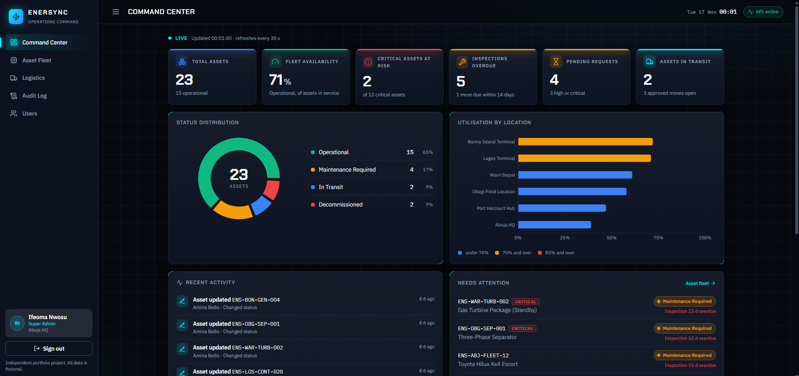
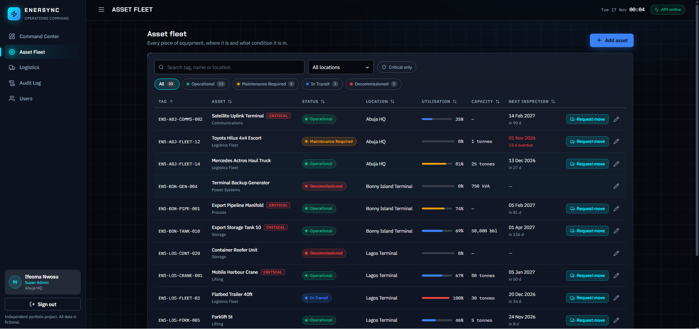
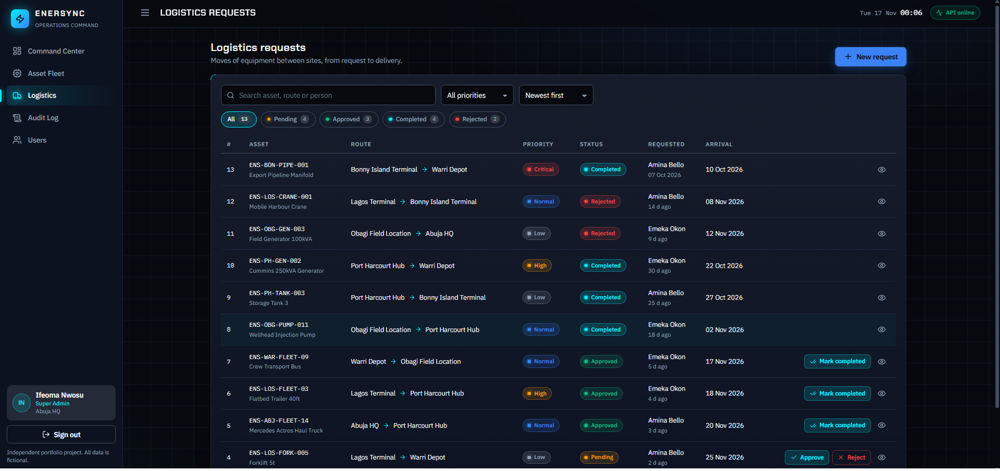
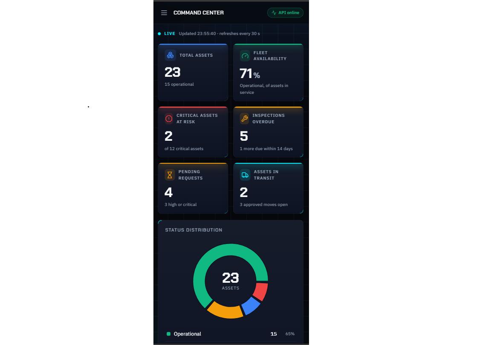

# Enersync

[](https://github.com/mfon-lhs/enersync/actions/workflows/ci.yml)

Enersync tracks energy-operations equipment (assets) and the requests to move it between locations. It records every change, and controls what each person can do by role.

**Live demo: https://enersync-web.onrender.com**

The demo runs on free hosting. If nobody has used it for 15 minutes, the API goes to sleep, so the first sign-in can take about a minute. After that it is fast.

This is an independent portfolio project, inspired by energy-operations logistics. It is not affiliated with TotalEnergies or any other company. All data in it is fictional.

## Screenshots

| Command Center | Asset Fleet |
|---|---|
|  |  |

| Logistics requests | On a phone |
|---|---|
|  |  |

## What it does

- **Command Center:** fleet availability, critical assets at risk, overdue inspections, pending requests, a status chart, utilisation by location and a recent-activity feed.
- **Asset Fleet:** search and filter the assets, add and edit them, and start a move request from any row.
- **Logistics:** raise requests, then approve, reject or complete them. A request follows fixed status rules, and completing one moves the asset to its destination.
- **Audit log:** every change is written to a log, in the same database transaction as the change. Rows can never be edited or deleted. Only a SuperAdmin can read it.
- **Users:** a SuperAdmin adds users, changes roles and deactivates accounts.
- **Roles:** SuperAdmin, LogisticsManager, FieldTechnician and Viewer. The server checks the role on every request. The interface only hides what a role cannot use.
- **Phone friendly:** tables become cards on small screens.

### Try it

Sign in with any of these fictional accounts. The password is given on request.

| Email | Role |
|---|---|
| i.nwosu@enersync.corp | SuperAdmin |
| a.bello@enersync.corp | LogisticsManager |
| e.okon@enersync.corp | FieldTechnician |
| t.adebayo@enersync.corp | Viewer |

## How it is built

```text
Browser  ->  Web app (React, Vite)  ->  API (FastAPI)  ->  PostgreSQL
```

| Part | Technology |
|---|---|
| API | Python, FastAPI, SQLAlchemy, JWT login, bcrypt passwords |
| Database | PostgreSQL 18 |
| Web app | React 19, Vite, React Router, Recharts, plain CSS |
| Tests | pytest for the API, Vitest and Testing Library for the web app |
| Quality checks | GitHub Actions: ruff, the tests, a production build and a Docker start-up check on every push |
| Packaging | Docker and Docker Compose |
| Hosting | Render (API and web app) and Neon (database), free plans |

Every design decision, the business rules and the open questions are written down in [docs/design.md](docs/design.md).

## Run it with Docker

You need Docker Desktop. One command starts the database, the API and the web app.

1. Copy `.env.example` to `.env` and fill in the three values (see the comments inside).
2. Stop anything else using ports 5173 or 8000 (such as `npm run dev` or `uvicorn`).
3. From this folder, run:

   ```powershell
   docker compose up --build
   ```

4. In a second terminal, give the demo users a password (you choose it):

   ```powershell
   docker compose exec backend python -m scripts.set_demo_passwords
   ```

5. Open http://localhost:5173 and sign in with one of the demo emails above.

The API documentation is at http://localhost:8000/docs.
To stop everything, press `Ctrl + C`. To delete the database too and start fresh, run `docker compose down -v`.

## Run it without Docker

You need Python 3.12 or newer, Node.js and PostgreSQL.

1. Create a database, then load `database/schema.sql` and `database/demo_data.sql` into it.
2. In `backend`, create a `.env` file with `DATABASE_URL` and `JWT_SECRET_KEY` (see `.env.example`), then:

   ```powershell
   python -m venv venv
   venv\Scripts\Activate.ps1
   pip install -r requirements.txt
   python -m scripts.set_demo_passwords
   python -m uvicorn app.main:app --reload --host 127.0.0.1 --port 8000
   ```

3. In `frontend`:

   ```powershell
   npm install
   npm run dev
   ```

4. Open http://localhost:5173.

## Run the tests

```powershell
cd backend
python -m pytest
cd ../frontend
npm test
```

The backend tests use a separate database called `enersync_test`, so they never change your real data.
